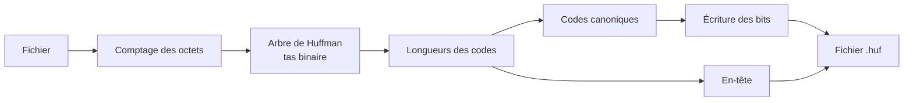

# huffman-compression

Compresseur de fichiers sans perte basé sur le codage de Huffman, écrit en Python pur (aucune dépendance externe).

```console
$ huffman compress texte.txt
texte.txt -> texte.txt.huf: 500000 -> 273897 bytes (54.8%)
$ huffman decompress texte.txt.huf -o copie.txt
texte.txt.huf -> copie.txt: 500000 bytes restored
```

## Objectif

Le codage de Huffman attribue des codes binaires courts aux symboles fréquents et des codes longs aux symboles rares. C'est l'une des briques de formats très répandus comme ZIP, gzip, PNG ou JPEG.

Le but du projet est de construire un vrai outil, pas seulement l'algorithme : compresser n'importe quel fichier, l'enregistrer dans un format auto-suffisant, le restaurer à l'identique et mesurer à quel point on s'approche de la limite théorique (l'entropie de Shannon).

## Fonctionnalités

- Compression et décompression de **n'importe quel fichier** (texte, image, binaire) : l'alphabet est l'octet, de 0 à 255.
- **Format `.huf` auto-suffisant** : l'en-tête contient tout ce qu'il faut pour décompresser, sans fichier annexe.
- **Codes canoniques** : seules les longueurs des codes sont stockées, pas l'arbre (même principe que DEFLATE, RFC 1951).
- **Construction déterministe** : la même entrée donne toujours exactement le même fichier compressé.
- **Cas limites gérés** : fichier vide, un seul octet distinct, les 256 valeurs d'octet.
- **Détection des fichiers invalides** : mauvaise signature, en-tête tronqué, longueurs de codes incohérentes, données tronquées.
- **Commande `stats`** : entropie, longueur moyenne des codes, taux de compression et table des codes.
- Script de **benchmark** reproductible, avec comparaison à zlib.

## Installation

Python 3.10 ou plus récent.

```bash
git clone https://github.com/5b6hgtms4y-boop/huffman-compression.git
cd huffman-compression
python -m venv .venv
source .venv/bin/activate        # Windows : .venv\Scripts\activate
pip install -e ".[dev]"          # installe la commande huffman et les outils de test
```

Sans installation, on peut aussi lancer `PYTHONPATH=src python -m huffman ...` depuis la racine du dépôt.

## Utilisation

### En ligne de commande

```bash
huffman compress fichier.txt              # crée fichier.txt.huf
huffman compress fichier.txt -o sortie.huf
huffman decompress fichier.txt.huf        # recrée fichier.txt
huffman decompress sortie.huf -o copie.txt --force   # écrase si le fichier existe
huffman stats fichier.txt --table 5       # statistiques + codes des 5 octets les plus fréquents
```

Exemple sur le mot `abracadabra` :

```console
$ huffman stats exemple.txt --table 5
file             : exemple.txt
original size    : 11 bytes
distinct symbols : 5
entropy          : 2.040 bits/symbol
average length   : 2.091 bits/symbol
compressed size  : 27 bytes (header 24 bytes)
ratio            : 245.45%

  byte     count  code
     a         5  0
     b         2  100
     r         2  111
     c         1  101
     d         1  110
```

Sur un fichier aussi petit, l'en-tête (24 octets) coûte plus cher que le gain : la compression n'est intéressante qu'à partir de quelques centaines d'octets.

### Depuis Python

```python
from huffman import compress, decompress, FormatError

blob = compress("Bonjour Compiègne".encode("utf-8"))
texte = decompress(blob).decode("utf-8")
```

## Tests et qualité

```bash
pytest                       # 131 tests
pytest --cov=huffman         # couverture : 99 %
ruff check src tests benchmarks
mypy src tests               # typage strict
```

Les tests couvrent chaque module séparément : construction de l'arbre, codes canoniques, écriture des bits, format de fichier, compression de bout en bout, statistiques et ligne de commande. Deux tests vérifient des propriétés mathématiques plutôt que des exemples :

- **optimalité** : sur des distributions aléatoires, le coût total du code (somme des fréquences fois les longueurs) est égal au coût optimal calculé par une méthode indépendante ;
- **borne de Shannon** : la longueur moyenne L respecte toujours H ≤ L < H + 1, où H est l'entropie.

Un workflow GitHub Actions relance le lint, le typage et les tests sous Python 3.10 à 3.13 à chaque push.

## Résultats

Mesures obtenues avec `python benchmarks/benchmark.py` (corpus de 500 000 octets générés avec une graine fixe, Python 3.13, Linux). Le taux est la taille compressée divisée par la taille d'origine : plus il est bas, mieux c'est.

| Corpus | Taille | Huffman | zlib -9 | Entropie | Longueur moy. | Compression | Décompression |
|---|---:|---:|---:|---:|---:|---:|---:|
| texte français | 500 000 o | 54,8 % | 29,4 % | 4,349 bit | 4,380 bit | 3,3 Mo/s | 4,0 Mo/s |
| code source Python | 22 082 o | 60,7 % | 31,0 % | 4,753 bit | 4,788 bit | 3,2 Mo/s | 3,7 Mo/s |
| octets biaisés | 500 000 o | 59,1 % | 66,5 % | 4,688 bit | 4,723 bit | 3,2 Mo/s | 3,8 Mo/s |
| octets aléatoires | 500 000 o | 100,1 % | 100,0 % | 8,000 bit | 8,000 bit | 3,2 Mo/s | 2,4 Mo/s |
| un seul octet | 500 000 o | 12,5 % | 0,1 % | 0,000 bit | 1,000 bit | 4,2 Mo/s | 12,3 Mo/s |

Ce qu'il faut retenir :

- Sur le texte, le code source et les octets biaisés, la longueur moyenne des codes reste à moins de 0,04 bit de l'entropie : on est très proche de la limite théorique pour un code octet par octet.
- Le cas « un seul octet » montre la limite de Huffman : un code fait au moins 1 bit, donc on ne descend jamais sous 12,5 %, même quand l'entropie vaut 0.
- Sur du texte, zlib fait mieux, parce qu'il repère aussi les **répétitions de mots** (LZ77) avant d'appliquer Huffman. Huffman seul ne regarde que la fréquence de chaque octet.
- Sur les « octets biaisés » (chaque octet tiré indépendamment des autres), il n'y a pas de répétition à exploiter : Huffman seul bat zlib.
- Des données aléatoires sont incompressibles : on perd seulement la taille de l'en-tête (526 octets).

## Comment ça marche



1. **Fréquences** : on compte les occurrences de chaque octet.
2. **Arbre** : on place une feuille par octet dans un tas binaire, puis on fusionne les deux nœuds les plus légers jusqu'à ce qu'il ne reste que la racine.
3. **Longueurs** : la profondeur de chaque feuille donne la longueur de son code.
4. **Codes canoniques** : on trie les symboles par (longueur, valeur) et on leur donne des codes consécutifs. Les longueurs suffisent donc à retrouver les codes.
5. **Écriture** : chaque octet est remplacé par son code, et les bits sont regroupés par 8.
6. **Décompression** : on relit l'en-tête, on reconstruit les codes puis l'arbre de décodage, et on descend dans l'arbre bit par bit jusqu'à avoir restauré le nombre d'octets attendu.

### Format `.huf`

Tous les entiers sont en big-endian.

| Position | Taille | Contenu |
|---:|---:|---|
| 0 | 4 | signature `HUF1` |
| 4 | 8 | taille d'origine en octets |
| 12 | 2 | nombre n de symboles distincts (0 à 256) |
| 14 | 2 n | n paires (symbole, longueur du code), triées par symbole |
| 14 + 2 n | ... | bits compressés, complétés par des zéros |

## Structure du dépôt

```
huffman-compression/
├── src/huffman/
│   ├── tree.py         # fréquences, arbre (tas binaire), longueurs des codes
│   ├── codes.py        # codes canoniques, inégalité de Kraft, arbre de décodage
│   ├── bitio.py        # écriture et lecture des bits
│   ├── fileformat.py   # en-tête du format .huf
│   ├── codec.py        # compress() et decompress()
│   ├── stats.py        # entropie, longueur moyenne, taux
│   ├── cli.py          # commandes compress, decompress, stats
│   └── __main__.py     # python -m huffman
├── tests/              # un fichier de tests par module
├── benchmarks/benchmark.py
├── .github/workflows/tests.yml
├── pyproject.toml
└── LICENSE
```

## Choix techniques

- **Des octets plutôt que des caractères.** Travailler sur les octets permet de compresser n'importe quel fichier et limite l'alphabet à 256 symboles, donc un en-tête de taille bornée. Pour du texte, il suffit de l'encoder en UTF-8.
- **Un tas binaire (`heapq`) pour construire l'arbre.** Extraire les deux plus petits nœuds coûte O(log k) au lieu de trier toute la liste à chaque tour. Chaque entrée du tas est un triplet (poids, numéro d'ordre, nœud) : le numéro départage les égalités, ce qui rend l'arbre déterministe et évite de comparer deux nœuds entre eux.
- **Des codes canoniques.** Plusieurs arbres de Huffman sont possibles pour une même entrée, mais les longueurs des codes suffisent à fixer un code unique. On stocke donc 2 octets par symbole au lieu de sérialiser l'arbre, et le décodeur reconstruit exactement les mêmes codes.
- **La taille d'origine dans l'en-tête.** Le décodeur sait quand s'arrêter, donc les bits de remplissage du dernier octet ne sont jamais lus. Pas besoin de stocker le nombre de bits de padding.
- **Un seul symbole distinct.** L'arbre n'a alors qu'une feuille, de profondeur 0. On lui donne un code de 1 bit, sinon les données seraient perdues.
- **Une validation stricte à la lecture.** L'inégalité de Kraft (somme des 2^-longueur ≤ 1) vérifie que les longueurs lues peuvent former un code préfixe. Un en-tête incohérent ou des données tronquées lèvent `FormatError` au lieu de produire un résultat faux.
- **Les bits dans un entier tampon.** `BitWriter` accumule les bits dans un petit entier et vide chaque octet complet dans un `bytearray`. La mémoire reste proche de la taille du résultat, contrairement à une chaîne de caractères "0"/"1" qui prend un octet par bit.
- **Un parcours sans récursion.** Le parcours de l'arbre utilise une pile explicite : un arbre très déséquilibré ne peut pas dépasser la limite de récursion de Python.

## Limites et pistes

- Python pur : environ 3 à 4 Mo/s. Une version en C++ ou un décodage par table (plusieurs bits à la fois) irait beaucoup plus vite.
- Huffman ne profite pas des répétitions. Ajouter une étape LZ77 avant Huffman, comme DEFLATE, rapprocherait les résultats de zlib.
- Le fichier est entièrement chargé en mémoire. Un traitement par blocs permettrait de compresser de très gros fichiers.
- Le format n'a pas de somme de contrôle. Un bit modifié dans les données compressées donne en général un résultat faux sans erreur, et des octets ajoutés en fin de fichier sont ignorés. Un CRC-32 dans l'en-tête, comme dans gzip, réglerait ces deux cas.
- Les longueurs de code ne sont pas plafonnées. En pratique elles restent courtes, mais DEFLATE les limite à 15 bits pour accélérer le décodage.

## Ce que j'ai appris

- Passer d'un algorithme qui marche sur un exemple à un **outil fiable** : format de fichier, cas limites, messages d'erreur, ligne de commande.
- Choisir une **structure de données** adaptée : le tas binaire a fait passer la construction de l'arbre de O(k³) à O(k log k) par rapport à ma première version.
- Relier le code à la théorie : entropie de Shannon, inégalité de Kraft, optimalité de Huffman, et vérifier ces propriétés **par des tests**.
- Manipuler des données au niveau du **bit** (décalages, masques, padding).
- Mettre en place un projet Python propre : paquet `src/`, `pyproject.toml`, Pytest, ruff, mypy strict, intégration continue.

## Contexte

Projet réalisé à l'origine en avril 2025 dans le cadre du cours INFO-F103 Algorithmique 1 à l'Université libre de Bruxelles (ULB), puis entièrement réécrit en 2026 : nouvelle architecture, format de fichier, ligne de commande, tests et mesures.

## Licence

MIT, voir [LICENSE](LICENSE).
